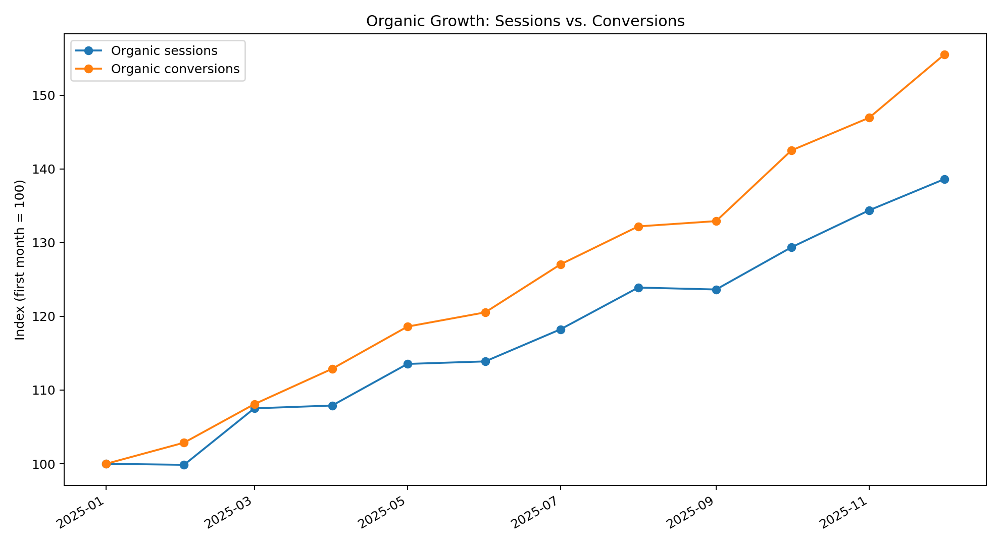
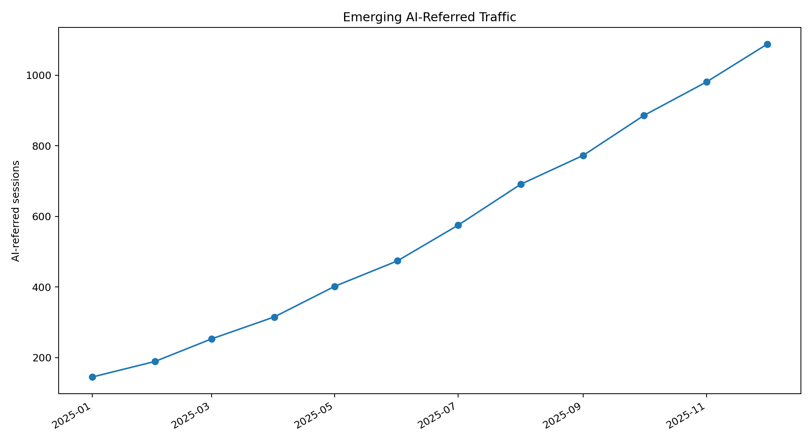
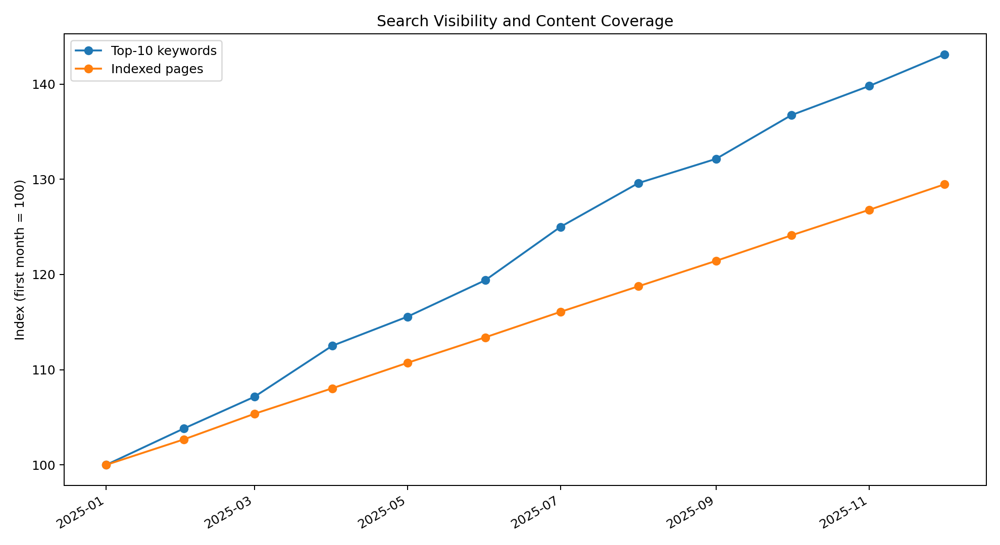

## Visual analysis

### Organic growth

### AI-referred traffic

### Search visibility and content coverage

## Illustrative insights from the sample dataset

- Organic sessions increase by approximately **39%** across the sample period.
- Organic conversions increase by approximately **56%**, showing that growth is not limited to traffic alone.
- Top-10 keyword visibility increases by approximately **43%**.
- AI-referred traffic grows rapidly from a small base, illustrating why emerging discovery channels should be monitored separately.
- Indexed content and ranking visibility move in the same general direction, supporting deeper analysis by landing-page type and search intent.

> The dataset is synthetic and these insights are illustrative. They demonstrate the measurement framework rather than employer or client results.
